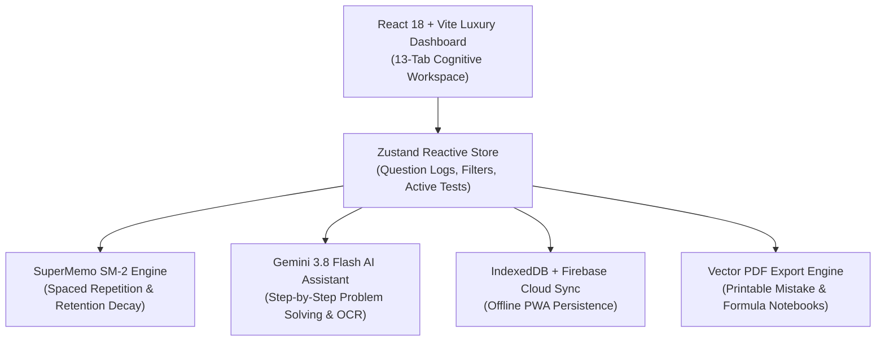

# JEE Workspace v2.0

[](https://jee-workspace.vercel.app)
[](https://react.dev/)
[](https://www.typescriptlang.org/)
[](https://vitejs.dev/)
[](https://tailwindcss.com/)
[](LICENSE)

> **Cognitive JEE Advanced Diagnostic Engine, Formula Memory Vault & NTA CBT Simulator**  
> Engineered by **Sudhanshu Gaddam** ([@0codedev](https://github.com/0codedev)) -- NIT Warangal.

---

## 🏛️ System Architecture



---

## ⚡ Core Capabilities

- **13-Tab Diagnostic Workspace:** Seamlessly navigates question logs, formula vaults, syllabus tracking, rank prediction, and burnout recovery.
- **NTA CBT Exam Simulator:** Full parity with official JEE Computer-Based Test environments and ExamGOAL JSON imports.
- **Formula Vault & Memory Anchors:** High-pitfall formulas with KaTeX mathematical rendering and cross-subject conceptual bridges.
- **SM-2 Spaced Repetition:** Scientifically schedules question re-attempts based on memory decay curves.
- **Burnout & Fatigue Radar:** Tracks study velocity and alerts students before cognitive fatigue impacts test performance.
- **AI Problem Solving Tutor:** Powered by Google Gemini 3.8 Flash for instant conceptual breakdown and hint generation.

---

## 🛠️ Tech Stack

- **Frontend:** React 18, TypeScript, Vite, Tailwind CSS, Lucide Icons
- **Math Rendering:** KaTeX, MathJax
- **State & Storage:** Zustand, IndexedDB, Firebase Cloud Firestore
- **AI Inference:** Google Gemini API (Gemini 3.8 Flash)
- **Deployment:** Vercel, PWA Offline Service Worker

---

## 🚀 Getting Started

### 1. Clone & Install
```bash
git clone https://github.com/0codedev/jee-workspace.git
cd jee-workspace
npm install
```

### 2. Configure Environment
```bash
cp .env.example .env
# Populate with your Gemini API key
```

### 3. Run Development Server
```bash
npm run dev
# Open http://localhost:5173 in your browser
```

---

## 📄 License
This project is licensed under the [MIT License](LICENSE).
